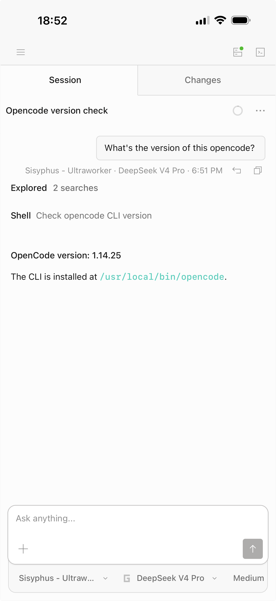

# OpenCode Railway Template

[中文说明](./README.zh-CN.md)

Deploy OpenCode on Railway with the pieces that matter in production: frontend + backend built from the same fork branch, browser-friendly auth, idle high-memory auto-restart, and automatic plugin refresh.

[](https://railway.com/deploy/opencode?referralCode=Se0h8C&utm_medium=integration&utm_source=template&utm_campaign=generic)



## Why This Template

1. **Build from the Railway fork branch, keep web and core on the same version**
   The image always clones `LaceLetho/opencode` branch `railway` and builds both `packages/app` and `packages/opencode`. This avoids the common mismatch where a pinned backend is paired with the upstream hosted frontend.

2. **Built-in monitor for idle high-memory restart**
   `monitor.sh` checks idle time and memory pressure. It only triggers a Railway restart / redeploy when the service has been idle long enough and non-cache memory is above the threshold, which keeps memory growth under control without restarting just because Linux is using spare RAM for file cache.

3. **Serverless sleep for lower cost**
   `railway.toml` enables `serverless = true` by default. When the service is unused, it can sleep and reduce cost; when traffic returns, Railway wakes it up again.

4. **`oh-my-openagent@latest` installed by default and refreshed on redeploy**
   Startup ensures `oh-my-openagent@latest` is present in OpenCode config. When Railway deployment id changes, cached plugin files are cleared so the latest version is fetched again. A restart within the same deployment keeps the cache for faster startup.

5. **Cookie-based browser auth that works better with Chrome and Safari**
   Browsers log in through `/login` and receive a secure session cookie. CLI and automation can still use HTTP Basic Auth. This works better for Web UI, PWA install flow, and WebSocket auth than relying on browser Basic Auth alone.

6. **Perfect mobile device access**
   The deployed OpenCode Web UI works smoothly from mobile browsers, so you can review sessions, inspect changes, and send prompts from your phone.

## Quick Start

1. Deploy with the Railway button above.
2. Mount a persistent volume at `/data`.
3. Set the required environment variables.
4. Open the Railway URL.
5. Sign in with username `opencode` and your password.

`/data` stores workspace files, OpenCode config, and runtime state across redeploys.

## Required Environment Variables

| Variable | Description |
| --- | --- |
| `OPENCODE_SERVER_PASSWORD` | Required. Login password for browser and CLI Basic Auth. |

## Common Optional Environment Variables

| Variable | Default | Description |
| --- | --- | --- |
| `OPENCODE_MODEL` | - | Default model for OpenCode. |
| `OPENCODE_SESSION_SECRET` | `OPENCODE_SERVER_PASSWORD` | Signing secret for browser session cookies. Set this explicitly if you run multiple instances. |
| `AUTH_REALM` | `RAILWAY_PUBLIC_DOMAIN` or `opencode` | Basic Auth realm. Usually no need to change it. |
| `ENABLE_OH_MY_OPENCODE` | `true` | Enable automatic injection of `oh-my-openagent@latest`. |
| `OMO_CONFIG_PROFILE` | - | Optional oh-my config profile. `default` loads `oh-my-opencode.default.json`; `team-a` loads `oh-my-opencode.team-a.json`; unset, `none`, `false`, or `off` leaves existing config untouched. |
| `ENABLE_OPENCLAW_PLUGIN` | `false` | When `true`, inject `@laceletho/plugin-openclaw` into `/data/.config/opencode/opencode.json`. |
| `ENABLE_MONITOR` | `false` | Enable the memory monitor and auto-restart logic. |
| `OPENCODE_RAILWAY_SLEEP_MODE` | `true` | Enable OpenCode's sleep-friendly Railway mode: no hosted UI proxy fallback, narrower UI `connect-src`, hidden-page event stream pause, and remote workspace sync pause by default. |
| `OPENCODE_ENABLE_REMOTE_WORKSPACE_SYNC` | `false` | Re-enable remote workspace SSE sync when Railway sleep mode is on. This can keep the service awake. |
| `LOG_LEVEL` | `WARN` | Wrapper log level. |
| `OPENCODE_STARTUP_TIMEOUT_MS` | `120000` | How long the wrapper waits for OpenCode's `/global/health` endpoint before giving up and exiting. |
| `OPENCODE_STARTUP_PROBE_TIMEOUT_MS` | `2000` | Per-attempt deadline for a single `/global/health` probe. Requests that OpenCode accepts but never answers are abandoned and retried instead of blocking startup. |
| `LOG_SLEEP_BLOCKERS` | `false` | Log inbound and outbound requests that can keep a Serverless service awake. |
| `PREPEND_PATH` | - | Extra PATH entries to inject before everything else. Useful for adding custom tool directories, e.g. `/data/.steel/bin:/data/.railway/bin`. |
| `SKILLS_UPDATE_ON_START` | `true` | Run `npx skills update -g` on each deploy to refresh globally installed skills. Set to `false` to skip. |

## Monitor Environment Variables

These matter only when `ENABLE_MONITOR=true`.

| Variable | Default | Description |
| --- | --- | --- |
| `RAILWAY_API_TOKEN` | - | Needed if the monitor should actually trigger Railway restart / redeploy. |
| `IDLE_TIME_MINUTES` | `10` | Required idle time before restart is allowed. |
| `MEMORY_THRESHOLD_MB` | `2000` | Restart only when pressure memory is above this threshold. On cgroup v2 this is `anon + kernel`, so reclaimable file cache from git/build/test activity is logged but ignored for restart decisions. |
| `CHECK_INTERVAL_SECONDS` | `60` | Monitor check interval. |
| `SLEEP_NET_LOG_IDLE_MINUTES` | `1` | When `LOG_SLEEP_BLOCKERS=true`, start logging TCP socket snapshots after this many idle minutes. |
| `SLEEP_NET_LOG_MAX_LINES` | `80` | Maximum active TCP socket lines to log per monitor snapshot. |

Railway injects `RAILWAY_PROJECT_ID`, `RAILWAY_ENVIRONMENT_ID`, and `RAILWAY_SERVICE_ID` automatically.

## Auth Modes

- Browser: visit `/login`, then the proxy issues a `Secure + HttpOnly + SameSite=Lax` session cookie.
- CLI / scripts: continue using HTTP Basic Auth.

Examples:

```bash
curl -u opencode:YOUR_PASSWORD https://your-app.up.railway.app/global/health
opencode attach https://your-app.up.railway.app/ -p YOUR_PASSWORD
```

## Sleep and Cost Control

- Railway Serverless is enabled by default, so idle services can sleep.
- `server.js` logs common wake-up sources to help debug why a service stays active.
- With `ENABLE_MONITOR=true`, the service can also auto-restart when it stays idle and non-cache memory usage becomes too high.

These solve different problems:

- `Serverless sleep`: reduce idle cost.
- `Memory monitor`: reduce long-running memory growth.

## Plugin Behavior

- The template injects `oh-my-openagent@latest` into `/data/.config/opencode/opencode.json` by default.
- Set `ENABLE_OPENCLAW_PLUGIN=true` if you also want to inject `@laceletho/plugin-openclaw`.
- Set `OMO_CONFIG_PROFILE=default` if you want startup to rebuild the oh-my config from `oh-my-opencode.default.json`.
- Add more bundled templates as `oh-my-opencode.<profile>.json`, then select one with `OMO_CONFIG_PROFILE=<profile>`.
- Leave `OMO_CONFIG_PROFILE` unset, or set it to `none`, `false`, or `off`, to avoid overwriting existing oh-my config.
- A new Railway deployment id triggers cache cleanup and re-download of the latest oh-my plugin.
- Restarts within the same Railway deployment keep the plugin cache on purpose, so startup stays fast and repeatable.

Disable this behavior with:

```bash
ENABLE_OH_MY_OPENCODE=false
```

## Manual Plugin Upgrade

OpenCode caches npm plugins under `~/.cache/opencode/packages/<spec>`. Running `opencode plugin <pkg> --force -g` updates the configured plugin spec, but it does not invalidate an existing cached `@latest` directory by itself.

If you need to force an already-installed plugin to refresh to the latest published npm version, remove the cached package directory first and then run the plugin install command again:

```bash
rm -rf ~/.cache/opencode/packages/@laceletho/plugin-openclaw@latest
opencode plugin @laceletho/plugin-openclaw --force -g
```

This is the recommended manual upgrade path for npm-based OpenCode plugins when a cached `@latest` entry is stale.

For `oh-my-openagent`, the template already automates the same cache-invalidation idea on Railway redeploy:

- the config is kept at `oh-my-openagent@latest`
- a new Railway deployment id clears the cached `oh-my-openagent@latest` package
- the next startup pulls the latest published version again

That mechanism is already the right fit for this template, so it does not need to be replaced with a manual `opencode plugin ... --force -g` step. If you want a same-deployment refresh without redeploying, use the manual cache-delete flow above.

## Local Run

```bash
npm install
OPENCODE_SERVER_PASSWORD=your-password \
ANTHROPIC_API_KEY=xxx \
npm run start
```

## Test

```bash
npm test
```
